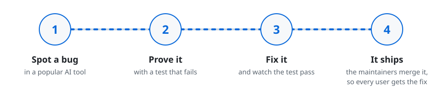

  

  <a href="https://www.linkedin.com/in/mabdullahbutt/"><b>LinkedIn</b></a> ·
  <a href="https://github.com/search?q=author%3A1AbdullahButt+is%3Apr+is%3Amerged+-user%3A1AbdullahButt&type=pullrequests"><b>All my merged fixes</b></a> ·
  <b>Follow me here</b> to see what I fix next

### In plain English

- **Companies like Microsoft, Google and NVIDIA publish the code behind their AI tools** so that anyone can improve it. I find bugs in that code and fix them. When the company accepts a fix, everyone who uses the tool gets it.
- **I also build AI products myself:** apps you can talk to, an assistant that answers WhatsApp messages, and a tool that reads invoices.
- **I come from fintech operations**, so I build for real business problems. Before this I made integrations that saved staff hours every workday.

### How a fix gets made

<b>For engineers: what goes into each fix</b>

 

- **Reproduced first**, usually in a clean Docker container pinned to the project's own versions.
- **A regression test that fails on the original code** and passes with the fix. Every merged PR has one.
- **Small diffs that follow the house rules**, such as changesets, changelog fragments, conventional commits, DCO sign-off or a CLA. All commits are signed.
- **Reviews lead with the verdict** and say what I ran. They give `file:line` suggestions I've checked against the code. I've reviewed in google/adk-python, langchain, haystack, microsoft/agent-framework and voice AI projects such as pipecat, livekit/agents and speechbrain.

---

### Recent fixes upstream

| Project | What was wrong, in plain words |
|---|---|
| [pipecat-ai/pipecat#6999](https://github.com/pipecat-ai/pipecat/pull/6999) | A voice-agent framework ran a filter on messages it was supposed to pass straight through |
| [collabora/WhisperLive#576](https://github.com/collabora/WhisperLive/pull/576) | Live captions kept showing an old, half-finished sentence after it was complete |
| [NVIDIA/ccluster#306](https://github.com/NVIDIA/ccluster/pull/306) | Saving cluster login details silently dropped a TLS security setting |
| [google/adk-go#2342](https://github.com/google/adk-go/pull/2342) | Logs could cut a character in half and print garbled text |
| [grafana/grafana#136705](https://github.com/grafana/grafana/pull/136705) | Dashboard filters stopped working after a page reload |
| [a2aproject/a2a-python#1460](https://github.com/a2aproject/a2a-python/pull/1460) | When an agent produced no output, a streaming request now fails with a clear error |
| [tauri-apps/tauri#16521](https://github.com/tauri-apps/tauri/pull/16521) | The upgrade command rejected a valid project setting inherited from the workspace |
| [shaka-project/shaka-player#10937](https://github.com/shaka-project/shaka-player/pull/10937) | Encrypted live video stopped playing once the stream ran long enough |

Also: 7 merged in [microsoft/TokenEconomizer](https://github.com/microsoft/TokenEconomizer/pulls?q=is%3Apr+author%3A1AbdullahButt+is%3Amerged), 6 in [microsoft/SkillOpt](https://github.com/microsoft/SkillOpt/pulls?q=is%3Apr+author%3A1AbdullahButt+is%3Amerged), and [more](https://github.com/search?q=author%3A1AbdullahButt+is%3Apr+is%3Amerged+-user%3A1AbdullahButt&type=pullrequests).

---

### What I've built

| Project | What it does, for anyone | Under the hood |
|---|---|---|
| **[WhatsApp, AWS and n8n agents](https://github.com/1AbdullahButt/whatsapp-aws-n8n-agents)** (demo) | Tenants report a repair by WhatsApp text or voice note and get a ticket back. A second agent reads supplier invoices and flags duplicates | FastAPI · AWS Lambda, SQS with dead-letter queues, DynamoDB, S3 · n8n · 99 of 108 invoice fields extracted correctly |
| **[Stoke](https://github.com/1AbdullahButt/stoke-showcase)** | Say what you ate in one sentence, and it logs each item with its calories and protein | Expo · Supabase · Groq Whisper speech-to-text |
| **[Fathom AI](https://github.com/1AbdullahButt/fathom-ai)** ([live demo](https://fathom-ai-tau.vercel.app)) | Meeting notes where every point links back to the exact words someone said, so you can check it | Next.js · Supabase · AssemblyAI · Groq · no bot joins the call |
| **[LendLoop](https://github.com/1AbdullahButt/lendloop)** ([live demo](https://lendloop-demo.vercel.app)) | Neighbours lend each other tools without exposing their personal details | Next.js · Clerk roles · Convex · signed, retried n8n webhooks |
| **[SureSend](https://github.com/1AbdullahButt/suresend)** ([live demo](https://suresend-demo.vercel.app)) | Stops a support reply that contradicts the latest docs, and suggests a correct one before the customer sees it | Next.js · TypeScript |
| **[MeowPay](https://github.com/1AbdullahButt/meowpay)** | A pretend bank for cats, where money is never lost halfway through a transfer | FastAPI · SQLite atomic transfers · passes all 25 black-box grader checks |
| **[AI Voice Orders](https://github.com/1AbdullahButt/AI-Voice-Order-Management)** | Phones customers, listens to their answer and updates their order | Flask · Twilio · Whisper · GPT-4o |

---

**Stack:** Python · TypeScript · SQL · React Native/Expo · Next.js · FastAPI · Supabase/Postgres · AWS (Lambda, SQS, DynamoDB) · OpenAI · Groq · n8n · Playwright · GitHub Actions · Claude Code
